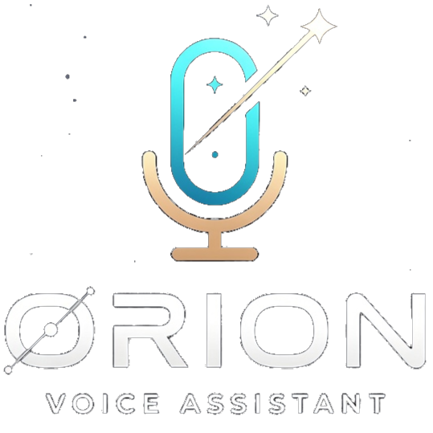
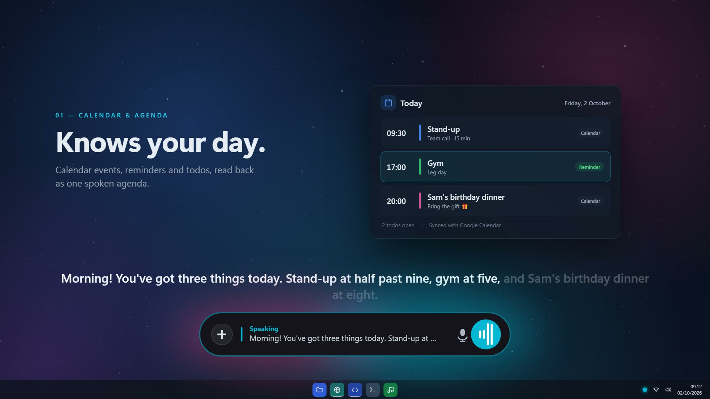
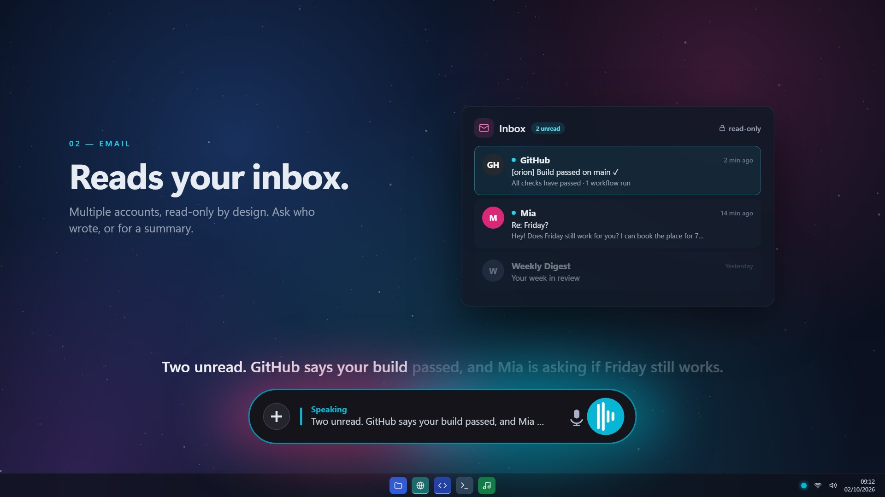
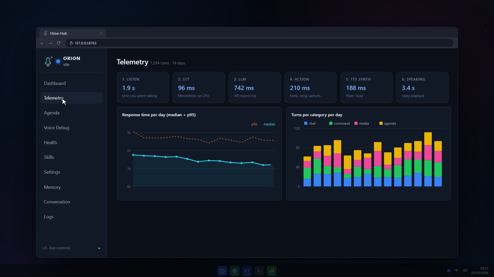
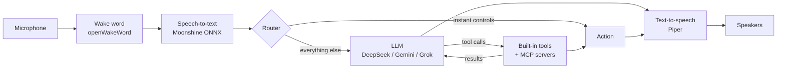

<p align="center">
  
</p>

<p align="center">
  <b>A voice assistant for Windows.</b><br>
  Say "Orion", ask for anything, and it answers out loud: it runs your apps,
  reads your email and calendar, identifies songs and controls your smart home.
</p>

<p align="center">
  
  
  
  
</p>

---

## Demo

<p align="center">
  <a href="https://oskarikaile.github.io/images/orion-demo.mp4">
    
  </a>
  <br>
  <a href="https://oskarikaile.github.io/images/orion-demo.mp4"><b>▶ Watch the demo video (1 min)</b></a>
</p>

## What it does

Orion runs in the background with a system tray icon and a small floating HUD.
The wake word, speech-to-text and voice all run locally on the CPU. Only the
transcribed text goes to the language model.

- **Talks naturally.** Barge in while it's speaking, reply without repeating
  the wake word, or add to a command you already gave ("change the song…
  and something calmer").
- **Uses tools.** The model picks from about 60 built-in tools (apps,
  reminders, email, calendar, media, smart home, PC control) plus any tools
  from connected **MCP servers**, and can chain steps: look something up,
  then act on it.
- **Knows your day.** Reminders, todos and Google Calendar events come
  together in one agenda, read out in a morning briefing with the weather
  and news.
- **Reads your inbox.** Multi-account IMAP, read-only by design.
- **Sees your screen.** "Explain my screen", "read this", "translate this".
- **Identifies songs.** Captures system audio and the mic and finds the
  track with Shazam.
- **Remembers you.** Durable facts plus a searchable archive of past
  conversations, recalled with local embedding search.
- **Recognises your voice.** Speaker verification with a lock mode and a
  privacy gate, so guests can't pull your personal context out of it.
- **Comes with a web dashboard.** The Universal Hub shows live telemetry,
  the agenda, settings, health checks, voice debugging and logs.

The full list is in [FEATURES.md](FEATURES.md).

<p align="center">
  
  
</p>

## How it works



1. **Listen.** A local [openWakeWord](https://github.com/dscripka/openWakeWord)
   model hears "Orion" in milliseconds, offline. An echo guard keeps Orion
   from hearing itself on loudspeakers.
2. **Transcribe.** Moonshine ONNX turns the command into text in about
   100 ms on the CPU, so the GPU stays free.
3. **Route.** Instant controls such as stop, mute and volume are handled
   locally. Everything else goes to the model with Orion's tool list attached,
   along with live state (pending reminders, todos, the time) and the
   relevant memory.
4. **Act.** The model calls tools through function calling. When a tool
   returns data, the result goes back to the model so it can take another
   step (capped by `MAX_TOOL_STEPS`). MCP tools sit next to the built-in ones.
5. **Speak.** Piper renders the reply one sentence at a time, so the first
   sentence plays while the rest is still rendering. Playback runs in its own
   process, so an audio crash can't take Orion down.

`llm/llm_router.py` decides which model answers. DeepSeek is the default
brain because it's cheap and good at tool routing. Screenshots and real-time
questions go to Gemini, which handles images and Google Search. If the main
backend fails, Gemini takes over.

### Project layout

```
orion.py            main loop: listen → think → act → speak
brain.py            local intent matching and self-knowledge
tools.py            tool definitions the model can call
mcp_client.py       MCP client: starts servers and exposes their tools
memory.py           facts, conversation recap and archive recall
config.py           every setting, grouped by section
audio/              wake word, STT, TTS, playback, speaker ID, song recognition
llm/                model bridges (DeepSeek, Gemini, Grok), router, mood
features/           agenda, reminders, email, briefing, smart home, vision, ...
ui/                 tray HUD, Universal Hub server, telemetry, debuggers
hub/                Hub front end (HTML/CSS/JS)
setup/              one-time setup scripts (voice, calendar, enrolment)
tests/              offline unit tests
```

## Setup

**You need:** Windows 10/11, Python 3.10–3.12, a microphone and a
[DeepSeek API key](https://platform.deepseek.com). A free
[Gemini API key](https://aistudio.google.com/apikey) is recommended for
screen vision and web questions.

```powershell
git clone <this-repo-url> orion
cd orion
python -m venv venv
.\venv\Scripts\Activate.ps1
pip install -r requirements.txt
```

**1. Add your keys.** Copy the template and fill it in. `secrets_local.py` is
git-ignored, so your keys never get committed.

```powershell
copy secrets_local.example.py secrets_local.py
```

```python
# secrets_local.py
DEEPSEEK_API_KEY = "sk-..."
GEMINI_API_KEY = "..."
```

Everything else in the template is optional: Grok, Home Assistant, Google
Maps and email accounts. Each feature switches itself off while its key is
blank. You can also set any of these as environment variables instead.

**2. Download the voice:**

```powershell
python setup/download_voice.py
```

**3. Run it:**

```powershell
python orion.py
```

Say **"Orion"**, then a request, or press `Ctrl+Alt+Space` to start listening.
Open the Hub from the tray, or say "open the hub" (`http://localhost:8765`).

### Optional extras

| Feature | How |
|---|---|
| **Instant wake word** | Train an openWakeWord model for "Orion" and save it as `models/o.onnx`. Without it, Orion falls back to phrase-based wake detection. |
| **Google Calendar** | Put your OAuth `credentials.json` in the project folder and run `python setup/setup_calendar.py`. |
| **Email** | Add accounts to `EMAIL_CREDENTIALS` in `secrets_local.py` (Gmail needs an app password). |
| **Speaker verification** | `pip install webrtcvad-wheels resemblyzer`, install CPU torch, then run `python setup/enroll_voice.py`. |
| **Smart home** | Set `HOME_ASSISTANT_URL` in `config.py` and the token in `secrets_local.py`. |
| **Desktop shortcut + autostart** | `python setup/setup_shortcuts.py` |
| **MCP servers** | Add entries to `MCP_SERVERS` in `config.py`. Filesystem (read-only) and fetch are set up already. |

## Voice commands

Phrasing is flexible: the model reads the whole sentence, so these are only
examples.

| Say | What happens |
|-----|--------------|
| `Orion, what's on for tomorrow?` | Agenda: events, reminders and todos |
| `Orion, remind me to call mom at 3pm` | Persistent reminder (mirrored to Google Calendar if it's for a later day) |
| `Orion, any new email?` | Unread senders across accounts |
| `Orion, what song is this?` | Identifies the music playing |
| `Orion, play some lofi` | Plays it on YouTube in a background tab |
| `Orion, explain my screen` | Describes what's on screen |
| `Orion, open Spotify` | Finds and launches the app |
| `Orion, work mode` | Runs a scene from `scenes.json` |
| `Orion, turn the lights to 30%` | Home Assistant |
| `Orion, run diagnostics` | Orion and PC health check |
| `Orion, only listen to me` | Owner-only lock mode |
| `Orion, stop` / `mute` / `exit` | Instant local controls |

## Configuration

Every setting lives in [`config.py`](config.py), grouped and commented. Most
of them can also be changed live from the Hub under **Settings**. To switch
the brain:

| `LLM_BACKEND` | What answers |
|---|---|
| `"deepseek"` *(default)* | DeepSeek for text and tool calls. Images and real-time questions go to Gemini. |
| `"gemini"` | Gemini for everything, including images and search. |
| `"grok"` | xAI Grok for everything. |

## Tests

```powershell
python -m unittest discover -s tests
```

The suite runs offline (no mic, network or models). It covers intent
matching, time parsing, agenda classification, the agentic tool loop, echo
detection and mood detection.

## Privacy

- Wake word, speech-to-text, text-to-speech and speaker verification run
  locally.
- Only the transcribed request goes to the model API. When someone other than
  the owner is speaking, personal facts and past conversations are left out
  of the prompt.
- Memory, reminders, the agenda, the voice profile, OAuth tokens and API keys
  are all stored locally and git-ignored.
